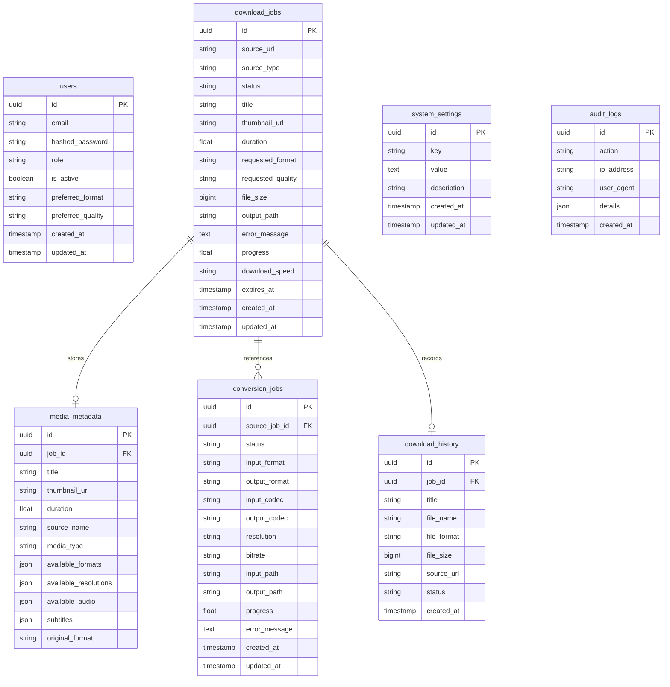

# MediaFlow — Database Schema & Architecture

MediaFlow utilizes SQLAlchemy 2.0 with asynchronous drivers (`aiosqlite` for local development, `asyncpg` for PostgreSQL in production), managed by Alembic database migrations.

---

## Entity Relationship Overview



---

## Tables & Column Definitions

### 1. `users`
Stores user profile, authentication, role access control, and user format preferences.
- `id`: UUID (Primary Key)
- `email`: VARCHAR(255), Unique, Indexed
- `hashed_password`: VARCHAR(255)
- `role`: VARCHAR(32) [admin, user, guest]
- `is_active`: BOOLEAN (Default True)
- `preferred_format`: VARCHAR(32) (e.g. mp4, mp3)
- `preferred_quality`: VARCHAR(32) (e.g. 1080p, 320k)
- `created_at`, `updated_at`: TIMESTAMP WITH TIME ZONE

### 2. `download_jobs`
Primary operational table tracking each active and completed media download.
- `id`: UUID (Primary Key)
- `source_url`: VARCHAR(2048)
- `status`: ENUM [pending, analyzing, downloading, processing, completed, failed, cancelled]
- `title`: VARCHAR(512)
- `thumbnail_url`: VARCHAR(2048)
- `duration`: FLOAT (in seconds)
- `requested_format`: VARCHAR(32)
- `requested_quality`: VARCHAR(32)
- `file_size`: BIGINT
- `output_path`: VARCHAR(1024)
- `progress`: FLOAT (0.0 to 100.0)
- `download_speed`: VARCHAR(64)
- `expires_at`: TIMESTAMP WITH TIME ZONE (Default +24 Hours)

### 3. `conversion_jobs`
Tracks media transcoding, container conversion, resolution downscaling, and audio extraction.
- `id`: UUID (Primary Key)
- `source_job_id`: UUID (Foreign Key -> download_jobs.id, Nullable for local uploads)
- `input_path`: VARCHAR(1024)
- `output_path`: VARCHAR(1024)
- `output_format`: VARCHAR(32)
- `resolution`: VARCHAR(32)
- `progress`: FLOAT

### 4. `system_settings`
Dynamic runtime configuration (e.g., max file size limits, banner notices, rate limit overrides).
- `key`: VARCHAR(128), Unique, Indexed
- `value`: TEXT
- `description`: VARCHAR(255)

---

## Migration Commands
```bash
# Generate new migration when models change:
python -m alembic revision --autogenerate -m "description"

# Apply pending migrations:
python -m alembic upgrade head
```

